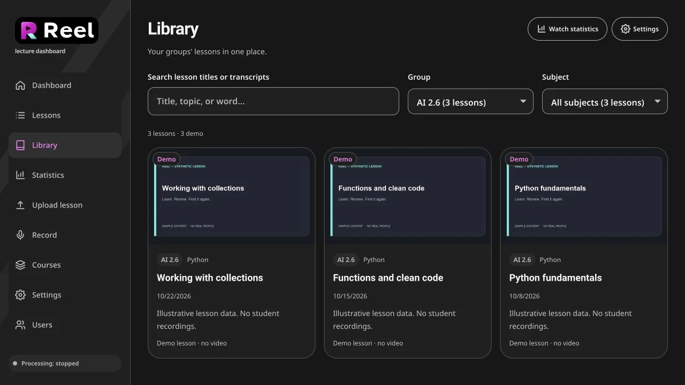
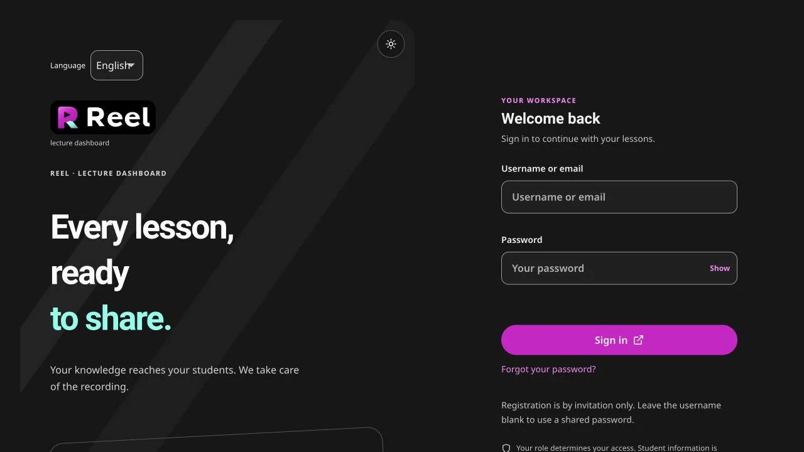
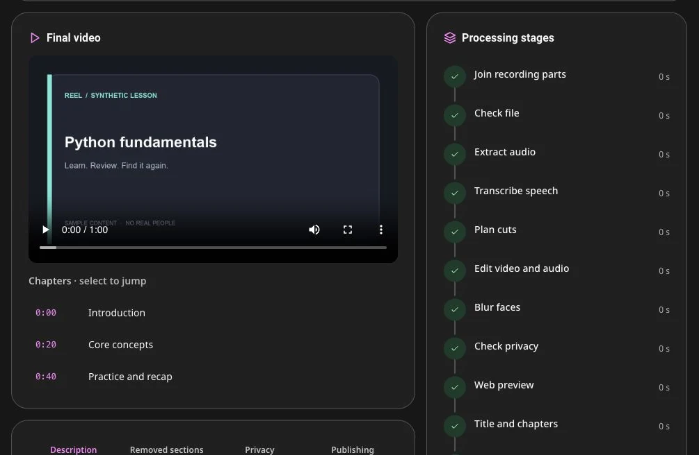
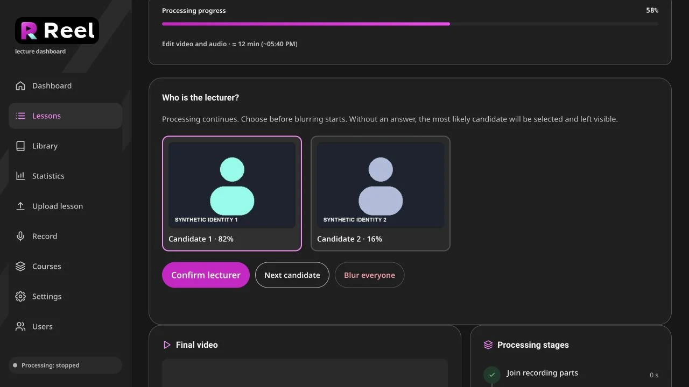
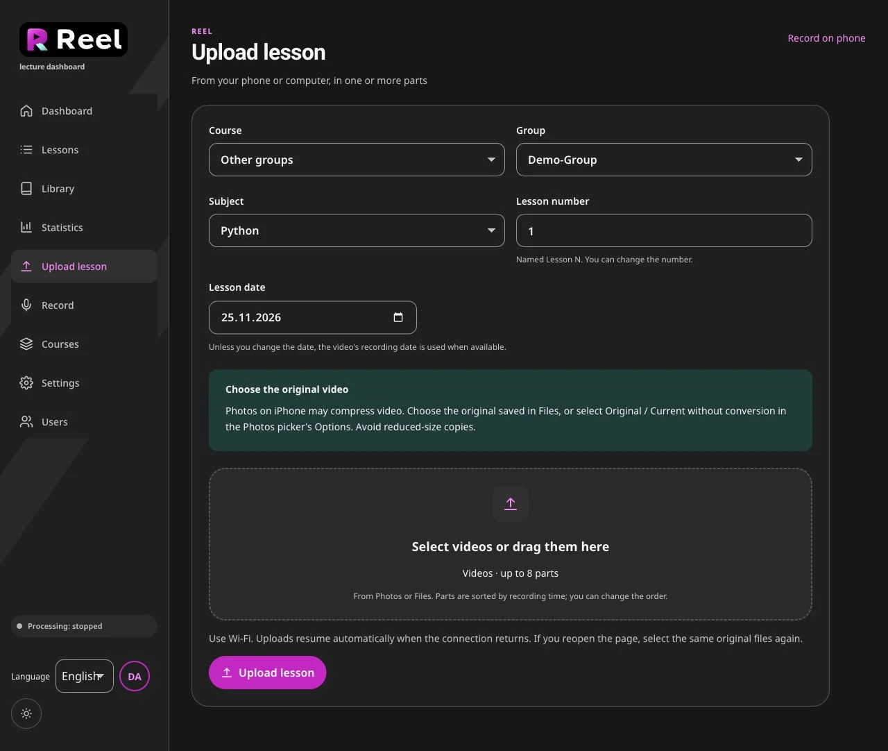
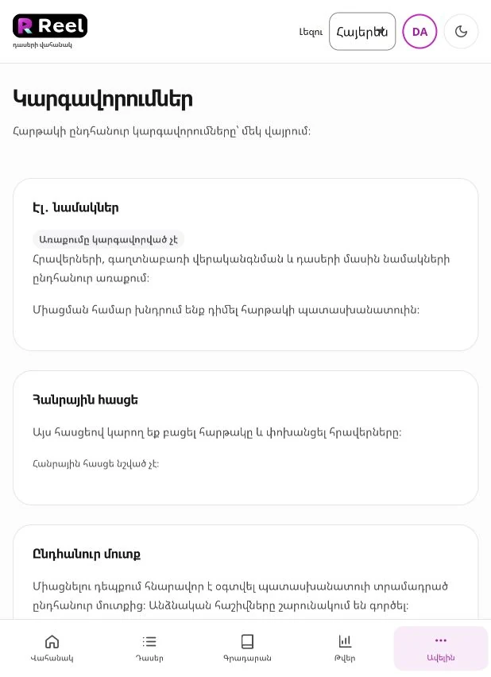

<p align="center">
  
</p>

# Reel

**From a classroom recording to a searchable lesson library.**

[](LICENSE)
[](docs/INSTALLATION.md)
[](https://github.com/3melkonyan/ReelProject/actions/workflows/checks.yml)

Reel is a FastAPI and Python lecture-processing app for Apple Silicon Macs. It joins recordings, transcribes speech, prepares conservative edits, adjusts framing and audio, and applies face blurring before publishing to YouTube and sharing with a class.



[Installation](docs/INSTALLATION.md) · [Usage](docs/USAGE.md) · [Administration](docs/ADMIN.md) · [Architecture](docs/ARCHITECTURE.md) · [Changelog](CHANGELOG.md)

## Features

- **Record and upload:** resumable uploads, browser recording and ordered multi-part lessons.
- **Choose your language:** Armenian by default, English selectable before sign-in or saved to a personal account. Transcription and generated-content languages are configured separately.
- **Review the lecturer after upload:** confirm a candidate, try the next or blur everyone while other processing continues. An unanswered review uses the top candidate when blurring starts.
- **Process and check:** local transcription, conservative cuts, audio normalization, optional board/projector framing and a separate final privacy scan. Buffered frame IO improves blur throughput; see the [synthetic benchmark](docs/ARCHITECTURE.md#performance).
- **Find and share lessons:** titles, chapters, captions, summaries, searchable transcripts, viewing progress, unlisted YouTube uploads and optional Slack, Classroom and email delivery.
- **Administer the library:** group-scoped accounts, email-verified administrator sign-in, audit records and resumable administrator-only lesson deletion across YouTube, Slack and the library.

Face recognition is imperfect. Uncertain or missed faces can remain visible; an automatic pass is not guaranteed anonymization. Review consent requirements and outputs before distributing a lesson. An unlisted YouTube link can be watched by anyone who has it.

## Screenshots

All screens use synthetic data. The local lesson preview contains a title card; lecturer candidates are silhouettes. No student recordings or personal details are shown.

| Sign in | Lesson library | Local lesson preview |
| --- | --- | --- |
| [](docs/images/login.webp) | [](docs/images/library.webp) | [](docs/images/lesson-player.webp) |
| **Progress and lecturer review** | **Upload** | **Armenian settings and language switch** |
| [](docs/images/job-review.webp) | [](docs/images/upload.webp) | [](docs/images/settings-hy-light.webp) |

## Requirements

- macOS on Apple Silicon; Python 3.12 is the tested development version.
- FFmpeg/ffprobe, Ollama, MLX Whisper, and the separately downloaded OpenCV YuNet/SFace models.
- At least 20 GB free to start processing; large recordings and model caches require more space.
- Your own credentials for configured publishing services; SMTP with STARTTLS for administrator codes and account emails.

VideoToolbox is preferred, with a software H.264 fallback. Other platforms and real-lesson performance improvements are not validated.

## Install

```sh
git clone https://github.com/3melkonyan/ReelProject.git
cd ReelProject
python3.12 -m venv .venv
source .venv/bin/activate
python -m pip install -r requirements.txt
cp config.example.yaml config.yaml
cp .env.example .env
```

These commands create a fresh installation. Continue with [Installation](docs/INSTALLATION.md) for system tools, model downloads, groups, SMTP and service authorization. Keep configuration, credentials, recordings, face references and databases out of Git.

## Run

After configuration, start the dashboard:

```sh
.venv/bin/python -m uvicorn reel.web.app:app --host 127.0.0.1 --port 8765
```

Open <http://127.0.0.1:8765>. Initial local credentials in `secrets/web.json` open first-account setup. Personal administrator sign-in subsequently requires email verification; configure SMTP first.

Start the processing worker in a second terminal:

```sh
.venv/bin/python -m reel.cli run
```

The dashboard and worker are separate processes. The worker performs real configured publications. For development, `REEL_DRY_RUN=1` substitutes publishing adapters but still processes recordings and writes data. Use an isolated checkout with synthetic media and no production credentials; see [Usage](docs/USAGE.md#development-without-publication).

## Language settings

Use **Language** on the sign-in page or in the navigation to choose Armenian or English. Personal preferences follow the account; before sign-in, the browser remembers the choice. Existing lesson content and user-entered names are retained.

| Configuration key | Purpose | Default |
| --- | --- | --- |
| `ui_language` | Deployment interface default: `hy` or `en` | `hy` |
| `transcription_language` | Speech language code or `auto` | `hy` |
| `transcription_prompt` | Optional recognition vocabulary; `null` disables it | Armenian vocabulary for Armenian speech |
| `metadata_language` | Generated lesson text: `hy` or `en` | `hy` |

See [Web dashboard](docs/WEB.md) for language preferences, lecturer review, access boundaries and deletion behavior.

## Development

```sh
.venv/bin/python -m pip install -r requirements-dev.txt
REEL_DRY_RUN=1 .venv/bin/python -m pytest -q
.venv/bin/python -m reel.config --smoke
```

For a uv-managed environment without pip, install development dependencies with `uv pip install --python .venv/bin/python -r requirements-dev.txt`.

Tests use temporary data, synthetic media and mocked services. Some require FFmpeg, face models or localhost access. [Core checks](https://github.com/3melkonyan/ReelProject/actions/workflows/checks.yml) run a smaller suite on GitHub Actions; complete media validation runs locally on macOS. See [Contributing](CONTRIBUTING.md).

## Documentation

- [Installation and models](docs/INSTALLATION.md), [service setup](docs/SETUP.md) and [access checklist](docs/KEYS.md)
- [Usage](docs/USAGE.md), [operator guide](docs/OPERATOR.md) and [background operation](docs/RUN.md)
- [Administration](docs/ADMIN.md), [dashboard](docs/WEB.md), [architecture](docs/ARCHITECTURE.md) and [design](docs/DESIGN.md)
- [Security reporting](SECURITY.md) and [third-party notices](THIRD_PARTY_NOTICES.md)

## License

Reel is released under the [MIT License](LICENSE). Bundled fonts and separately downloaded models retain their respective licenses. Maintained by [Gevorg Melkonyan](https://github.com/3melkonyan). Use [GitHub Issues](https://github.com/3melkonyan/ReelProject/issues) for reproducible bugs and feature requests.
