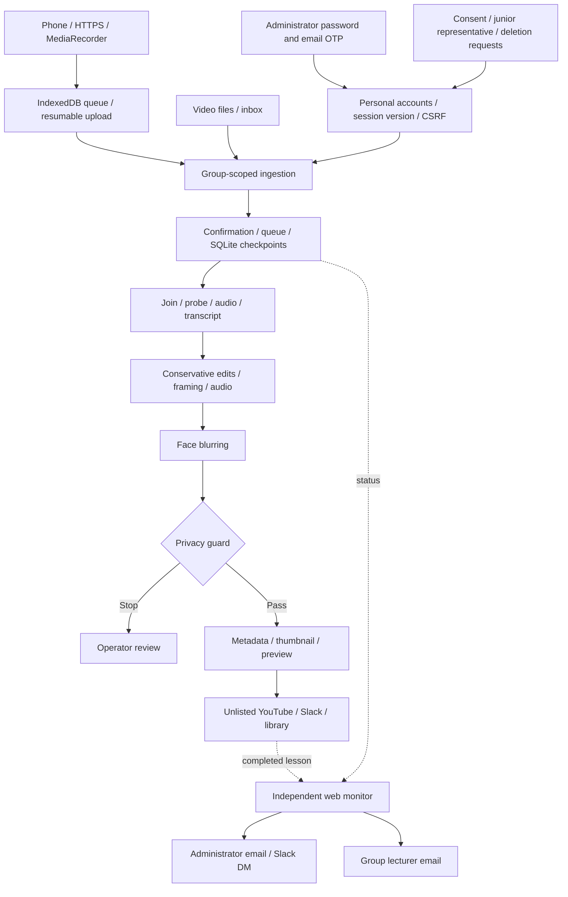

# Reel architecture

## Data and access boundaries

- SQLite stores accounts, groups, jobs and stage checkpoints. The pipeline owns stage resumption and publication idempotency.
- Original and unblurred recordings are not served by the web application. Viewer/student previews and thumbnails use existing privacy and group checks. Identity crops are administrator-only.
- Browser recording parts are not a lesson until confirmed and can be removed beforehand. A restarted MediaRecorder creates a new continuation part rather than arbitrary concatenation of a broken container.
- IndexedDB is not durable backup. Mobile operating systems may suspend cameras or evict storage. Wake Lock cannot guarantee continuity.
- An administrator password alone does not grant a personal session. OTP challenges are separate, hashed and limited by expiry/attempts. Remembered devices apply after password verification. SMTP failure does not bypass authentication.
- Raw OTP codes and remembered-device tokens are not stored in the database. Session cookies are signed, not encrypted, and contain no OTP or secret payload.
- Consent versions and representative declarations are stored during registration. The application does not independently verify a parent's identity or certify legal compliance.
- Administrators review deletion requests, including external YouTube/Slack copies. Closing a request does not by itself establish that every external copy was removed.

## Monitoring

`reel.notifications` and `reel.lesson_report` run in the web lifespan every 60 seconds; they do not start the worker. For an active job, a missing worker, less than 5 GB free disk, or failed YouTube/Slack stages can create an incident. Slack alerts target active administrators' personal DMs; completion emails target the job group's lecturers.

Recipient/channel deliveries are claimed in the database to avoid duplicates. When SMTP/Slack delivery is ambiguous, inspect `notification_delivery.state`; automatic retry deliberately avoids potentially resending a completed delivery.

The local monitor cannot detect a full host outage or the failure of its own web process. An external uptime monitor is separate deployment work.

## Encoding and execution

The dashboard and worker are independent processes. `reel.encoding` probes VideoToolbox once using synthetic pixels and selects `libx264` if hardware encoding is unavailable. This changes the H.264 encoder, not blurring or privacy policy. Preview encoding uses a separate low-priority process with progress observation.

See [Installation](INSTALLATION.md) and [Usage](USAGE.md) for supported setup and commands.
