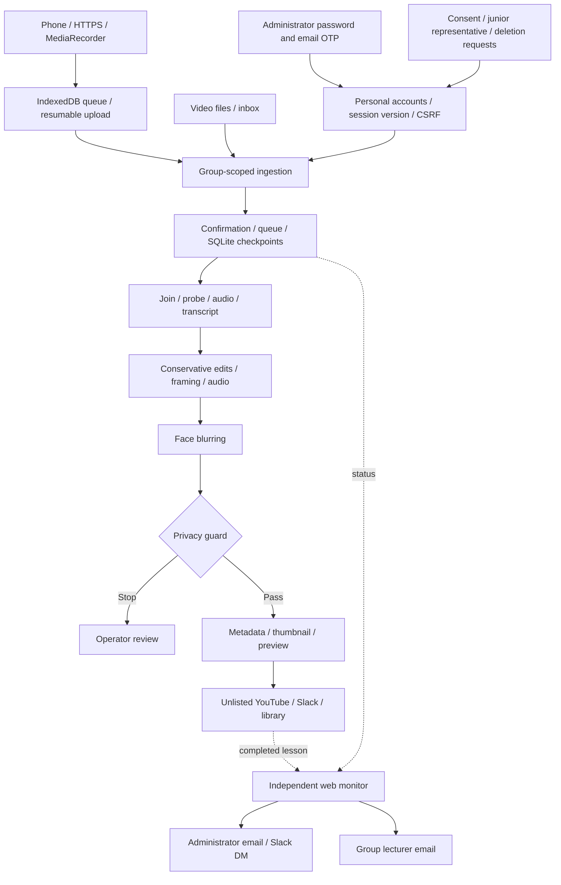

# Reel architecture

## Data and access boundaries

- SQLite stores accounts, groups, jobs and stage checkpoints. The pipeline owns stage resumption and publication idempotency.
- Original and unblurred recordings are not served by the web application. Viewer/student previews and thumbnails use existing privacy and group checks. Upload-review identity crops are available to the uploader and administrators; other identity inspection is administrator-only.
- Browser recording parts are not a lesson until confirmed and can be removed beforehand. A restarted MediaRecorder creates a new continuation part rather than arbitrary concatenation of a broken container.
- IndexedDB is not durable backup. Mobile operating systems may suspend cameras or evict storage. Wake Lock cannot guarantee continuity.
- An administrator password alone does not grant a personal session. OTP challenges are separate, hashed and limited by expiry/attempts. Remembered devices apply after password verification. SMTP failure does not bypass authentication.
- Raw OTP codes and remembered-device tokens are not stored in the database. Session cookies are signed, not encrypted, and contain no OTP or secret payload.
- Consent versions and representative declarations are stored during registration. The application does not independently verify a parent's identity or certify legal compliance.
- Administrator lesson deletion requests cancellation of running processing, waits for worker release, backs up job database state and tracks YouTube, Slack and library cleanup. Failed steps are retryable; source media and database history remain. Privacy-erasure requests are a separate consent workflow.

## Lecturer review and languages

Upload completion schedules an early keyframe scan. The uploader and administrators can confirm one of up to three candidates or blur everyone. Processing continues; at blur entry an unanswered review selects the highest-ranked candidate. Scan/match failures use the blur-everyone fallback. The first final answer and saved references are recorded locally.

Armenian is the interface default and English is selectable. Browser preferences apply before sign-in; personal account preferences take precedence afterward. `ui_language` sets the deployment default, independently of `transcription_language`, `transcription_prompt` and `metadata_language`. The catalog files live in `reel/locales/`.

## Monitoring

`reel.notifications` and `reel.lesson_report` run in the web lifespan every 60 seconds; they do not start the worker. For an active job, a missing worker, less than 5 GB free disk, or failed YouTube/Slack stages can create an incident. Slack alerts target active administrators' personal DMs; completion emails target the job group's lecturers.

Recipient/channel deliveries are claimed in the database to avoid duplicates. When SMTP/Slack delivery is ambiguous, inspect `notification_delivery.state`; automatic retry deliberately avoids potentially resending a completed delivery.

The local monitor cannot detect a full host outage or the failure of its own web process. An external uptime monitor is separate deployment work.

## Encoding and execution

The dashboard and worker are independent processes. `reel.encoding` probes VideoToolbox once using synthetic pixels and selects `libx264` if hardware encoding is unavailable. This changes the H.264 encoder, not blurring or privacy policy. Preview encoding uses a separate low-priority process with progress observation.

See [Installation](INSTALLATION.md) and [Usage](USAGE.md) for supported setup and commands.

## Performance

Raw-frame reads and writes overlap face processing through a fixed buffer pool.
Detection, recognition, tracking and pixelation remain ordered on the processing
thread. The final privacy scan independently detects faces on the completed
blurred video at the existing sampling rate. Full-resolution processing uses
three buffers, about 48 MiB more buffer memory for 4K video.

A single sequential synthetic benchmark on macOS (15 logical CPUs, software
H.264 fallback) measured a 900.022-second, 3840×2160 clip with fictional faces at
multiple sizes and nominal 24 fps. Timings include profiling overhead:

| Phase | Before | Buffered IO |
| --- | ---: | ---: |
| Lecturer discovery | 14.8 s | 13.8 s |
| Source face analysis | 133.7 s | 133.1 s |
| Blur and encoding | 628.7 s | 536.2 s |
| Independent privacy scan | 151.0 s | 134.5 s |
| Total | 928.3 s | 817.6 s |

Total elapsed time decreased 11.9%, with average combined CPU occupancy rising
from 5.4 to 6.6 cores. The output MP4 files were byte-identical:
21,578 frames, all 5,940 reference blur applications retained, and 4,500 independent
scan samples with zero warnings or unexplained faces in each run. A linear
90-minute projection of this synthetic workload is 92.8 versus 81.8 minutes.
Real-lesson validation and real-lesson speedup remain unmeasured; hardware encoding
was unavailable for this benchmark. Use `tools/profile_blur.py` and
`tools/compare_privacy.py` to measure and verify another recording. Measurements
belong under ignored `out/performance/`.
